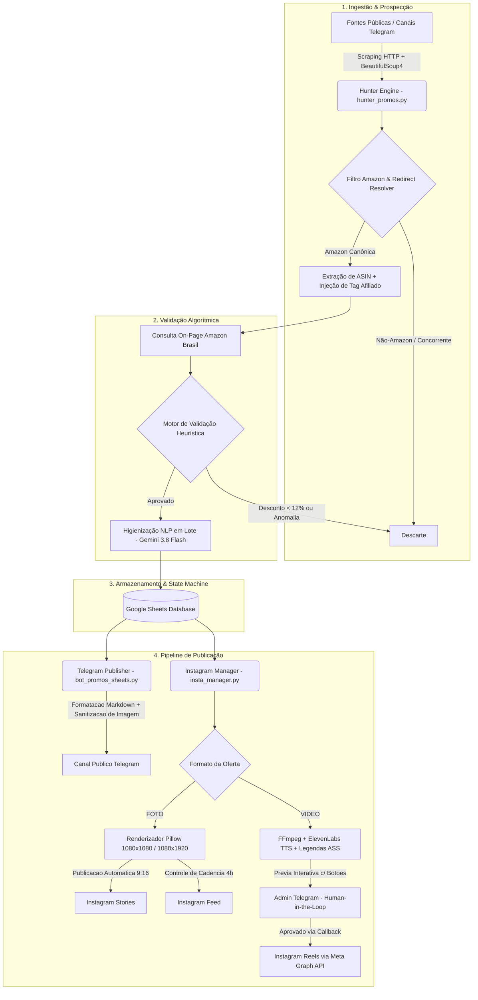

# Bug das Promos — Autonomous Affiliate Marketing Engine

[](https://www.python.org/)
[](https://github.com/features/actions)
[](https://developers.facebook.com/)
[](https://ai.google.dev/)
[](https://elevenlabs.io/)
[](https://core.telegram.org/bots/api)

> **Sistema autônomo e serverless de prospecção, validação algorítmica e distribuição omni-channel de ofertas de e-commerce (Amazon Brasil), com pipeline de inteligência artificial generativa, síntese de voz neural e aprovação interativa *Human-in-the-Loop*.**

---

## 📌 Visão Geral do Projeto

O **Bug das Promos** é uma plataforma de automação ponta a ponta projetada para operar de forma 100% autônoma na nuvem através do **GitHub Actions**. O sistema monitora feeds públicos e canais de ofertas em tempo real, filtra exclusivamente produtos da Amazon Brasil, injeta tags de afiliado, valida a veracidade e consistência matemática dos descontos e distribui o conteúdo automaticamente no **Telegram** e no **Instagram** (Feed, Stories e Reels).

Para garantir excelência visual e curadoria de conteúdo, o pipeline combina visão computacional, renderização gráfica programática em tempo real (**Pillow**), processamento de vídeo com queima de legendas sincronizadas (**FFmpeg**), clonagem de voz neural (**ElevenLabs**) e processamento de linguagem natural (**Google Gemini**).

---

## 🏗️ Arquitetura do Sistema



---

## 🚀 Destaques de Engenharia e Desafios Resolvidos

### 1. Resiliência de Scraping e Resolução de Redirecionamentos
- **Bypass de Firewalls Anti-Bot:** Evita bloqueios de CDN (Cloudflare) consultando a camada web pública de mensageria com rotação de headers e tempos de espera assíncronos.
- **Rastreamento de Saltos HTTP (301/302):** Segue até 8 saltos de redirecionamento para decodificar encurtadores intermediários, links agregadores e páginas com meta-refresh, isolando o produto final.
- **Canonicidade de Links:** Reconstrói links diretamente pelo padrão oficial `https://www.amazon.com.br/dp/{ASIN}?tag={AMAZON_TAG}`, eliminando parâmetros de rastreamento externos antes de submeter ao encurtador.

### 2. Validação Matemática e Detecção de Inconsistências
- **Heurística de Piso por Categoria:** Bloqueia automaticamente promoções fantasmas (por exemplo, "Ar Condicionado Split por R$ 59,90" decorrente de captura de valor de controle remoto ou parcela solta de 10x).
- **Validação de Desconto Real:** Exige comprovação matemática de desconto mínimo de 12% entre o preço base e o promocional, ou presença de cupom válido na página.
- **Detecção de Cupons Dinâmicos:** Identifica e extrai automaticamente badges de cupom on-page na Amazon (ex: *10% OFF no checkout*).

### 3. Otimização de Custos e Consumo de IA (Zero Cota Queimada)
- **Extração Híbrida (Python First):** 100% dos preços, cupons e títulos preliminares são extraídos via Expressões Regulares (Regex) e parsing DOM em Python nativo.
- **Processamento em Lote (Batch Processing):** Apenas itens previamente validados pelo Python são enviados para o Google Gemini em uma **única chamada consolidada**, higienizando até 10 produtos de uma só vez.
- **Fallback Multi-Modelo:** Sistema resiliente com fallback automático entre `gemini-3.8-flash-lite`, `gemini-3.8-flash` e higienização determinística local.

### 4. Integração Oficial com a Meta Graph API (v21.0)
- **Publicação Serverless de Mídia:** Criação de containers de mídia assíncronos (`/{ig-user-id}/media`), polling de status de renderização da Meta e disparo final (`/{ig-user-id}/media_publish`).
- **Aspect Ratio Nativo:** Renderização vertical 9:16 (1080x1920) com background blur adaptativo para Stories, eliminando distorções de escala.
- **Algoritmo de Proteção de Audiência:** Controle de cadência de postagens (mínimo de 4 horas entre publicações no Feed e teto de 3 posts diários), evitando saturação de feed e canibalização do alcance algorítmico.

### 5. Controle Human-in-the-Loop via Telegram
- **Prévia Interativa com Callback Query:** Vídeos e Reels são enviados previamente ao chat do administrador com botões inline (`Aprovar` / `Descartar`).
- **Interpretação de Linguagem Natural (NLP):** O administrador pode responder a qualquer mensagem de prévia com instruções em texto livre (ex: *"Muda o preço para 89,90 e coloca cupom TECH10"*). O Gemini interpreta a intenção, aplica as alterações na planilha e regera o criativo automaticamente.

---

## 🛠️ Stack Tecnológica

| Componente | Tecnologia | Finalidade |
| :--- | :--- | :--- |
| **Linguagem** | Python 3.11 | Core de execução e scripts de automação |
| **Orquestração / CI-CD** | GitHub Actions | Agendamento via Cron (execução a cada 30 min) e ambiente serverless |
| **Banco de Dados** | Google Sheets API (gspread) | State Machine relacional de baixo custo e visualização em tempo real |
| **Visão Computacional / Design** | Pillow (PIL) | Composição dinâmica de banners 1080x1080 e 1080x1920 com tipografia personalizada |
| **Processamento Audiovisual** | FFmpeg | Renderização de vídeo H.264, zoompan contínuo e legendagem dinâmica ASS |
| **Voz Neural (TTS)** | ElevenLabs API / edge-tts | Locução dinâmica em português com voz neural de alta fidelidade |
| **LLM / Inteligência Artificial** | Google Gemini (google-genai) | Sanitização de títulos, classificação de vitrine e NLP de comandos admin |
| **APIs de Distribuição** | Meta Graph API & Telegram Bot API | Publicação automatizada em canais, feed e stories |

---

## 📂 Estrutura do Repositório

```text
├── .github/
│   └── workflows/
│       ├── main.yml                 # Pipeline CI/CD principal (Cron a cada 30 min)
│       └── publicar_teste.yml       # Workflow manual de testes de publicação
├── hunter_promos.py                 # Módulo 1: Web scraping, resolução de ASIN e validação
├── bot_promos_sheets.py             # Módulo 2: Processamento e despacho no canal do Telegram
├── insta_manager.py                 # Módulo 3: Geração de criativos (Foto/Reels) e API da Meta
├── publicar_teste_insta.py          # Utilitário de teste direto de integração com Instagram
├── FotoIG.jpg                       # Asset base de identidade visual da marca
├── .gitignore                       # Isolamento de chaves, credenciais e arquivos temporários
└── README.md                        # Documentação técnica do sistema
```

---

## ⚙️ Variáveis de Ambiente e Configuração

O sistema foi concebido sob o princípio de **12-Factor App**, isolando totalmente as configurações sensíveis via variáveis de ambiente (armazenadas em **GitHub Secrets**):

| Variável | Descrição |
| :--- | :--- |
| `GEMINI_API_KEY` | Chave de acesso à API do Google Gemini |
| `TELEGRAM_TOKEN` | Token do bot gerado via BotFather |
| `TELEGRAM_CHAT_ID` | Canal público de destino (ex: `@OBugdasPromos`) |
| `ADMIN_CHAT_ID` | ID numérico do chat do administrador para aprovações interativas |
| `GOOGLE_CREDENTIALS` | JSON da Service Account do Google Cloud com permissão no Google Drive/Sheets |
| `NOME_DA_PLANILHA` | Nome da planilha utilizada como banco de dados (ex: `BugdasPromos`) |
| `AMAZON_TAG` | Tag de afiliado Amazon para monetização (ex: `bugdaspromo07-20`) |
| `IG_ACCESS_TOKEN` | Token de Acesso de Longa Duração / Permanente da Meta Graph API |
| `IG_USER_ID` | Identificador da conta profissional do Instagram |
| `ELEVENLABS_API_KEY` | Chave da API ElevenLabs para síntese de áudio neural |
| `ELEVENLABS_VOICE_ID` | ID da voz customizada para locução de Reels |

---

## 💻 Execução Local

### Pré-requisitos
- Python 3.11+
- FFmpeg instalado no sistema operacional

### Instalação
```bash
# 1. Clone o repositório
git clone https://github.com/Mickaell-Oliveira/botdaspromos.git
cd botdaspromos

# 2. Crie e ative um ambiente virtual
python -m venv venv
source venv/bin/activate  # No Windows: venv\Scripts\activate

# 3. Instale as dependências
pip install gspread google-auth google-genai requests feedparser beautifulsoup4 cloudscraper Pillow edge-tts
```

### Execução dos Módulos
```bash
# Executa a caça e validação de ofertas da Amazon
python hunter_promos.py

# Publica ofertas pendentes no canal do Telegram
python bot_promos_sheets.py

# Processa a fila de publicação do Instagram (Feed, Stories e aprovações de Reels)
python insta_manager.py
```

---

## 🛡️ Segurança e Boas Práticas

- **Credenciais Seguras:** Nenhuma credencial ou token privado reside no código-fonte. Todo o acesso a APIs de terceiros é mediado exclusivamente por injeção de ambiente em tempo de execução.
- **Higienização de Entradas:** Validação de strings, prevenção contra injeção de parâmetros em chamadas HTTP e sanitização estrita de URLs antes do encurtamento.
- **Tolerância a Falhas:** Timeouts configurados em todas as chamadas de rede, blocos de tratamento de exceção com fallback estruturado e logs descritivos para monitoramento no GitHub Actions.
